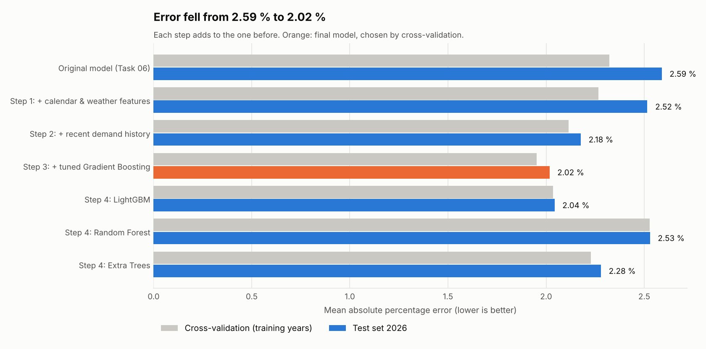
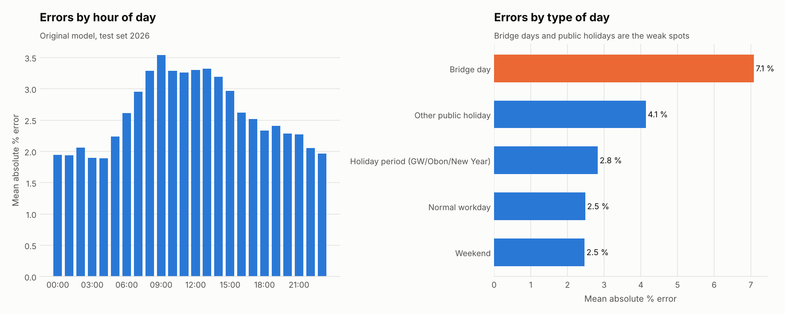
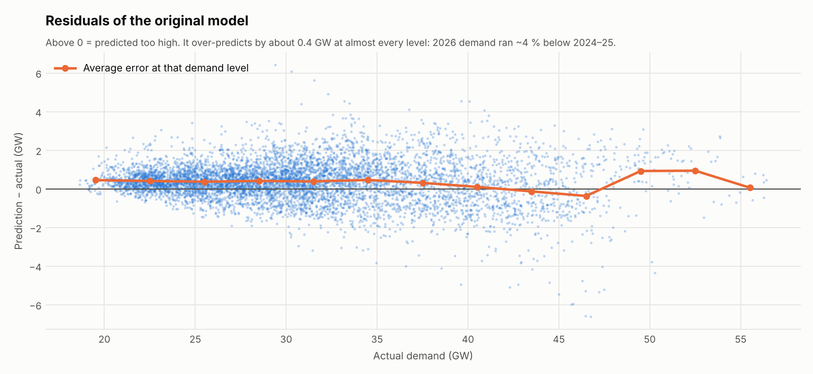
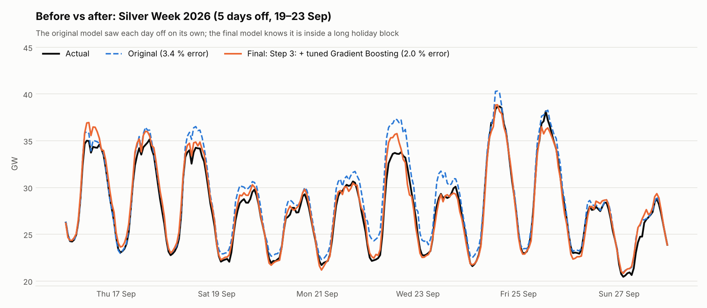
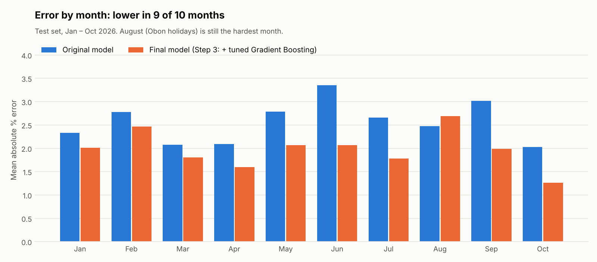
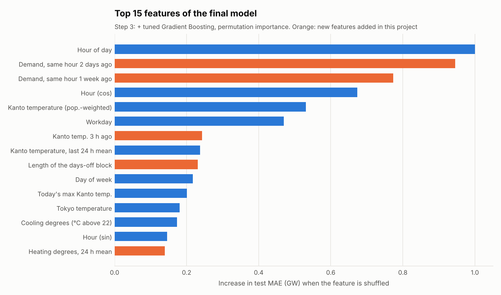

# Evaluating and Improving the Tokyo Electricity Demand Model

This project takes the machine learning model from [Tokyo-Electricity-Demand-Prediction](https://github.com/Sylvi007/Tokyo-Electricity-Demand-Prediction), a Gradient Boosting model that predicts hourly electricity demand in the Tokyo (TEPCO) area, evaluates it in depth, finds its weaknesses and improves it.

**Result:** test error fell from **2.59 % to 2.02 %** (−22 %), R² rose from 0.975 to **0.982**, and the share of hours predicted within 3 % went from 67 % to **78 %**.

**Data:** 39,744 hourly records from 1 Apr 2022 to 12 Oct 2026 (JST). Demand comes from TEPCO Power Grid "でんき予報"; weather comes from the Japan Meteorological Agency (気象庁). Data © TEPCO Power Grid and JMA (processed), compiled through [kaseee/tokyo-grid-lab](https://github.com/kaseee/tokyo-grid-lab).



## Fair-comparison rules
- Every model uses the same data and the same split: training on **Apr 2022 – Dec 2025**, testing on **Jan – Oct 2026** (6,840 unseen hours).
- The final model is **chosen by time-series cross-validation** (4 time-ordered folds in the training years), never by the test set. The test set is used only to report the results.

## 1. Evaluation of the original model

| Metric | Value | Meaning |
|---|---:|---|
| MAPE | 2.59 % | Average error relative to demand |
| MAE | 0.81 GW | Average size of the error |
| RMSE | 1.09 GW | Punishes big misses more |
| R² | 0.975 | Share of the variation in demand explained |
| Max error | 6.63 GW | Worst single hour |
| Bias | +0.34 GW | Systematically predicts too high |
| Peak-hours MAPE | 2.80 % | Error in the top 5 % of demand hours |
| Hours within 3 % | 67 % | Share of hours that are close enough to be useful |
| Cross-validation MAPE | 2.32 % | Average over 4 folds in 2022–2025 |

## 2. Weaknesses found



1. **Bridge days** (a workday between days off) have **7.1 %** error, nearly 3 times the error on normal workdays.
2. **Public holidays** have **4.1 %** error. The model doesn't know whether a holiday is a single day or part of a long block: the middle day of Silver Week 2026 had 9.7 % error.
3. **Drift:** demand in 2026 was about **4 % lower** than in 2024–25, so the model over-predicts almost everywhere (bias **+0.34 GW**).
4. **Sudden cold snaps,** such as the snowy Sunday of 8 Feb 2026, are under-predicted.
5. **Daytime hours** (08:00–14:00) have the largest errors, peaking at 09:00 (3.5 %), when offices start up.



## 3. Improvements tried

| Step | What changed | Targets |
|---|---|---|
| **1. Better preprocessing** | **+9 features.** Calendar: bridge day, previous/next day off, length of the days-off block, holiday period (Golden Week / Obon / New Year). Weather: today's minimum temperature, temperature 3 h ago, 24 h heating- and cooling-degree averages | Weaknesses 1, 2, 4 |
| **2. Recent demand history** | **+4 features:** demand at the same hour 2 days ago and 1 week ago, plus the average and peak demand 2 days ago. These are **already known when forecasting the next day**, so there is no data leakage | Weakness 3 (drift) |
| **3. Hyperparameter tuning** | `RandomizedSearchCV`: 20 settings × 4 time-series folds | General accuracy |
| **4. Different algorithms** | LightGBM, Random Forest and Extra Trees on the same 30 features | Is another algorithm better? |

## 4. Comparison

| Model | CV MAPE | Test MAPE | MAE (GW) | RMSE (GW) | R² | Bias (GW) | Peak-hours MAPE | Within 3 % |
|---|---:|---:|---:|---:|---:|---:|---:|---:|
| Original model | 2.32 % | 2.59 % | 0.81 | 1.09 | 0.975 | +0.34 | 2.80 % | 67 % |
| Step 1: + calendar & weather features | 2.27 % | 2.52 % | 0.79 | 1.05 | 0.976 | +0.30 | 2.61 % | 67 % |
| Step 2: + recent demand history | 2.11 % | 2.18 % | 0.69 | 1.00 | 0.979 | +0.08 | 2.75 % | 76 % |
| **Step 3: + tuned Gradient Boosting (final)** | **1.95 %** | **2.02 %** | **0.64** | **0.91** | **0.982** | **+0.09** | **2.44 %** | **78 %** |
| Step 4: LightGBM | 2.04 % | 2.04 % | 0.65 | 0.93 | 0.981 | +0.08 | 2.67 % | 78 % |
| Step 4: Random Forest | 2.53 % | 2.53 % | 0.80 | 1.15 | 0.972 | +0.14 | 3.13 % | 70 % |
| Step 4: Extra Trees | 2.23 % | 2.28 % | 0.72 | 1.05 | 0.977 | +0.14 | 2.89 % | 74 % |

The full table, with max error and special-day error, is in [`model_comparison.csv`](model_comparison.csv).

## 5. Final model: tuned Gradient Boosting

It was chosen because it had the **lowest cross-validation error** (1.95 %), and it was also the best on the test set.

| | Original | Final | Change |
|---|---:|---:|---:|
| MAPE | 2.59 % | **2.02 %** | −22 % |
| MAE | 0.81 GW | **0.64 GW** | −21 % |
| RMSE | 1.09 GW | **0.91 GW** | −16 % |
| R² | 0.975 | **0.982** | +0.007 |
| Bias | +0.34 GW | **+0.09 GW** | drift almost removed |
| Peak-hours MAPE | 2.80 % | **2.44 %** | better when the grid is most stressed |
| Bridge-day MAPE | 7.08 % | **5.29 %** | −25 % |
| Public-holiday MAPE | 4.14 % | **1.98 %** | −52 % |







**What helped most:** the recent-demand features (step 2) gave the largest gain and almost removed the 2026 drift. The calendar features fixed most of the holiday errors.

**Still weak, reported honestly:** bridge days are still the hardest days (5.3 %). **August got slightly worse** (2.47 % → 2.69 %), because the Obon holidays fall differently every year. Next steps would be real weather *forecasts* instead of observed weather, and a company-holiday calendar.

## Files

All files are in one folder.

| File | Contents |
|---|---|
| `model_evaluation_and_improvement.ipynb` | Notebook: evaluation, weaknesses, improvements, comparison and selection. Start here. |
| `improve.py` | All the code: new features, metrics, cross-validation, tuning, comparison and charts |
| `original_model.py` | The original model's code, unchanged |
| `final_model.joblib`, `final_model_info.json` | The selected final model and its details |
| `model_comparison.csv` | Every model and every metric |
| `error_by_day_type.csv` | Error by type of day, before and after |
| `test_predictions_before_after.csv` | Actual, original and final predictions for every test hour |
| `fig1_…png` to `fig6_…png` | Charts |
| `tokyo_hourly_clean.csv.gz` | The data |
| `requirements.txt` | Python packages |

## How to run
```bash
pip install -r requirements.txt
python improve.py        # about 10 minutes, mostly the hyperparameter search
```
